# Society Cart

> **"Indian aunties have been bulk-bargaining for years. Society Cart gives that proven behaviour the technology to scale, powered by Nexconn."**

[](https://docs.nexconn.ai)
[](https://react.dev/)
[](https://fastapi.tiangolo.com/)
[](https://www.mongodb.com/)
[](https://groq.com/)
[](https://societycart.vercel.app/)

---

## 1. The Idea

Why does every family in the same 100-flat apartment complex buy their own 5 kg bag of Sona Masoori rice, their own 2 L bottle of sunflower oil, and their own packets of Aashirvaad atta at retail markups, delivered by 30 different delivery riders every single day?

Indian aunties figured out the collective buying model decades ago: when neighbours pool demand and buy in bulk straight from wholesale mandis and distributors, prices drop by **15% to 30%**. But when modern urban apartment societies try to coordinate collective grocery orders over general messaging apps, the process descends into chaos: messages get buried, quantities are ambiguous, flat numbers are missing, and volunteers burn out doing hours of manual spreadsheet bookkeeping.

**Society Cart is NOT a grocery delivery or quick-commerce app.** We do not run dark stores or employ delivery fleets. Instead, Society Cart gives apartment communities the digital infrastructure to unlock their collective buying power. Powered by the **Nexconn Chat SDK**, residents coordinate their orders inside an apartment group chat. An AI engine extracts messy multilingual requests into structured items, an automated aggregator builds a consolidated wholesale shopping manifest and flat-by-flat packing breakdown, and an exact reconciliation billing engine generates itemized flat bills comparing wholesale rates against verified retail benchmarks.

---

## 2. Links & Project Information

| Resource | URL / Value |
| :--- | :--- |
| **Live Web Application** | [https://societycart.vercel.app/](https://societycart.vercel.app/) |
| **Demo Video Walkthrough** | [Google Drive Video Demo](https://drive.google.com/file/d/1f0KVyIQmX_8K-d1MjsLpwQdGtNm8J4P2/view?usp=sharing) |
| **Public GitHub Repository** | [https://github.com/VivekGoudAdula/society-cart](https://github.com/VivekGoudAdula/society-cart) |
| **Challenge Track** | **Social & Community** (Nexconn Build Challenge 2026) |
| **Nexconn App Key** | `y745wfm8yna6v` *(Configured in Production & Demo)* |
| **Nexconn SDK Packages** | `@nexconn/chat` (`^26.5.1`), `@nexconn/engine` (`^26.5.1`) |

> [!NOTE]
> Following Nexconn zero-trust security architecture, the private `NEXCONN_APP_SECRET` strictly resides on the backend environment. It is never exposed in client bundles or repositories.

---

## 3. End-to-End Workflow

Society Cart coordinates the full bulk-buying lifecycle across 7 deterministic stages:

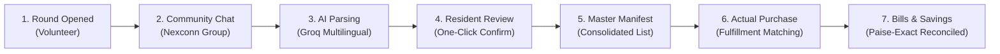

1. **Round Opened by Volunteer**: The volunteer (Logistics Controller) schedules a collective buying round with a cutoff deadline and target shopping date. A real-time system announcement is automatically published to the Nexconn society group chat.
2. **Residents Request in Group Chat**: Residents post their grocery requirements naturally in English, Telugu, Hindi, or mixed code-switching (Hinglish/Tenglish) within the persistent Nexconn society channel.
3. **AI Multilingual Extraction**: Every chat message is tied to a two-phase reservation and parsed by the Groq-powered AI engine. Products, numeric quantities, standardized units, brands, variants, and categories are extracted into structured JSON.
4. **Resident Confirmation**: Extracted items appear on the resident's personal dashboard for review. If an item was vague (e.g., *"thoda coriander"*), the AI flags it for clarification. Once verified, the resident clicks **Confirm Order**.
5. **Master Manifest & Flat Packing Compilation**: When the round cutoff passes, the volunteer compiles the Master Manifest. Identical items are consolidated by canonical category and unit for wholesale purchasing, while maintaining a flat-by-flat packing breakdown for physical distribution.
6. **Purchase Fulfillment & Cost Allocation**: The volunteer records actual store receipts from D-Mart or wholesale mandis. The robust product matching engine maps purchased goods against manifest items (handling transliterations like *Ashirvad Aata* $\leftrightarrow$ *Aashirvaad Atta*).
7. **Paise-Exact Bills & Verified Savings**: The backend allocates costs proportionally to each flat, generates immutable itemized bills, and verifies bulk savings against authenticated retail benchmarks. A privacy-safe announcement is dispatched to the Nexconn group chat notifying residents that bills are ready.

---

## 4. Screenshots & Visual Walkthrough

All screenshots are located under [`/docs/screenshots/`](file:///c:/HACKATHONS/78.%20NEXCONN%20CHALLENGE%20-%20RESKILL/APP/society-cart/docs/screenshots):

| # | Screen | Description |
| :-: | :--- | :--- |
| **01** | 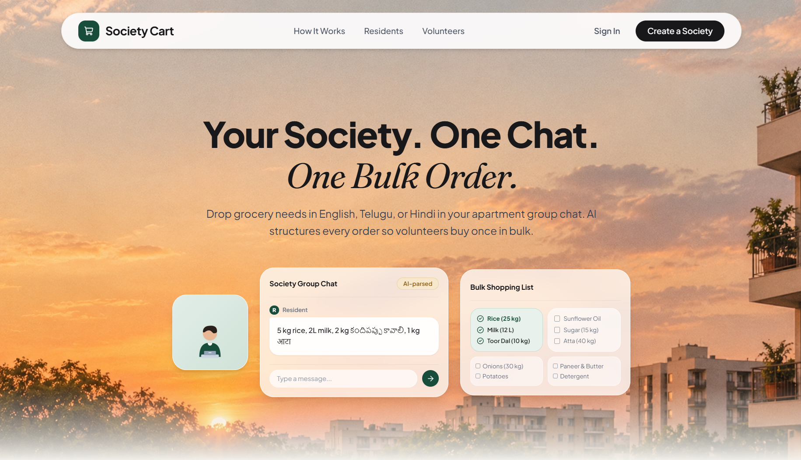 | **Landing Page**: Editorial introduction to collective community group buying. |
| **02** | 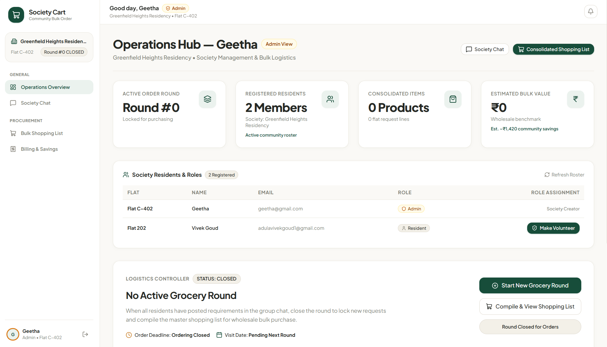 | **Operations Hub**: Volunteer command center for opening rounds, tracking deadlines, and managing order lifecycles. |
| **03** | 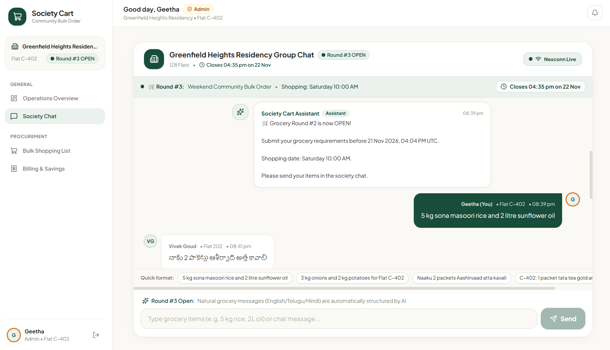 | **Society Chat (Volunteer View)**: Real-time Nexconn group chat displaying round announcements and resident requests. |
| **04** | 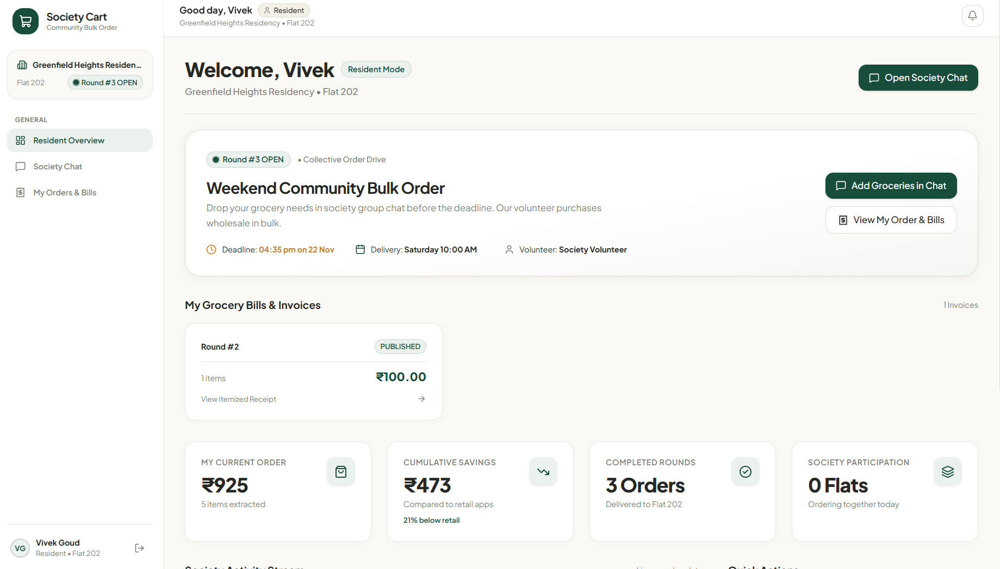 | **Resident Dashboard**: Personal status hub showing active order round countdown and flat orders. |
| **05** | 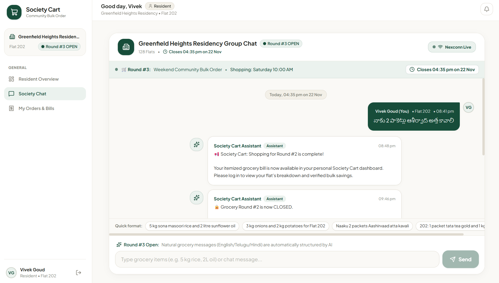 | **Society Chat (Resident View)**: Conversational ordering in English, Telugu, and Hindi backed by Nexconn Chat SDK. |
| **06** | 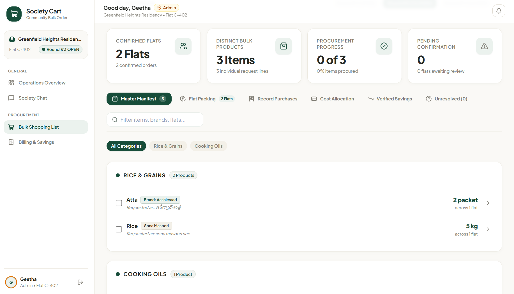 | **Master Manifest**: Consolidated wholesale shopping list organized by canonical grocery categories. |
| **07** | 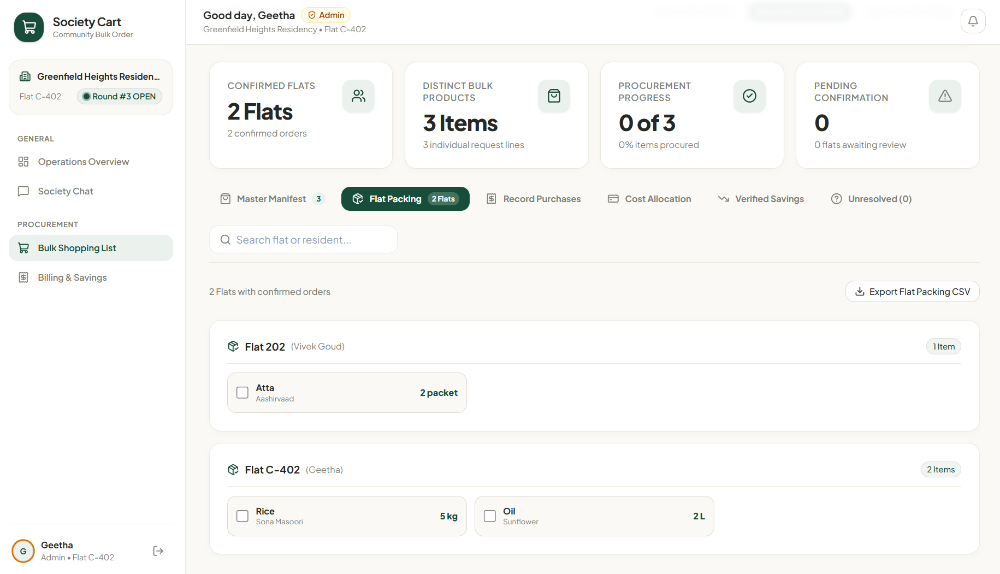 | **Flat-by-Flat Packing**: Distribution breakdown showing exact item allocations for each apartment flat. |
| **08** | 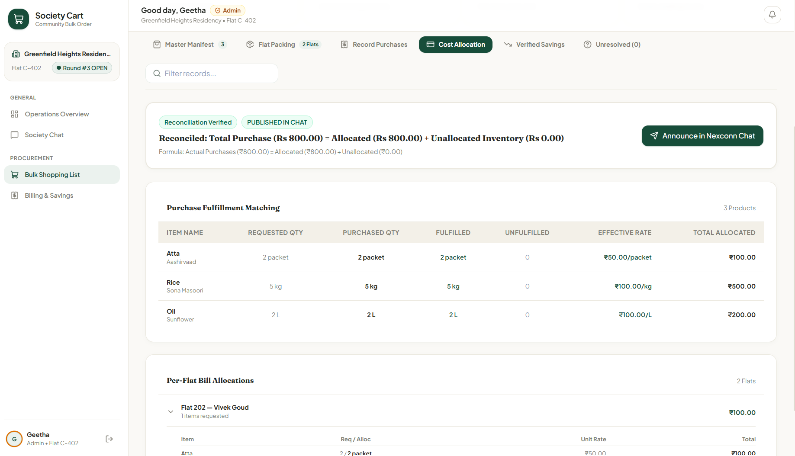 | **Record Purchases & Cost Allocation**: Receipt entry, fuzzy transliteration matching, and mathematical reconciliation. |
| **09** | 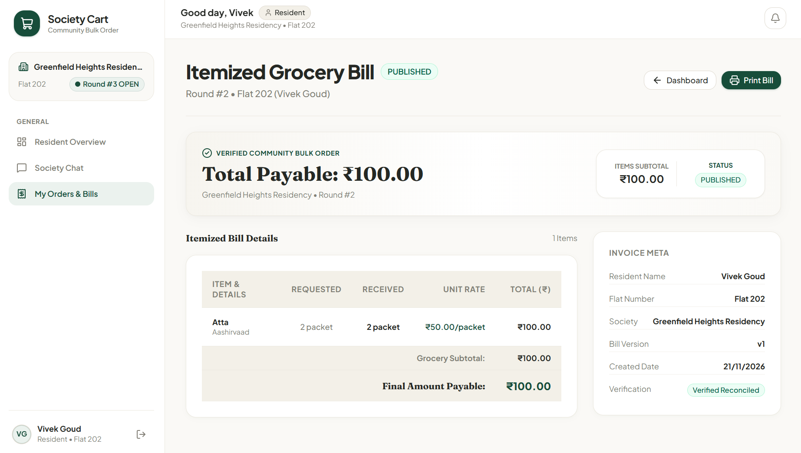 | **Resident Bill & Verified Savings**: Itemized flat bill with paise precision and benchmark retail price comparison. |

---

## 5. Nexconn Chat SDK Integration (Deep Dive)

Judges can verify the real, deep usage of the **Nexconn Web Chat SDK** across both client and server layers. Society Cart does not use mock chat widgets: every message, channel, token, and system announcement passes through the live Nexconn edge network.

### Nexconn Packages Used
- **`@nexconn/chat`** (`v26.5.1`): Manages engine initialization, group channels, message streaming, event listeners, and channel query pagination.
- **`@nexconn/engine`** (`v26.5.1`): Handles underlying WebSocket transport, Singapore edge gateway routing (`AreaCode.SG`), and reconnection state machines.

### Nexconn Feature Mapping in Society Cart

| Nexconn Feature | Role & Behavior in Society Cart | Implementation File & Function |
| :--- | :--- | :--- |
| **Server Token Generation** | Generates cryptographically signed user access tokens using SHA1 nonces and backend `NEXCONN_APP_SECRET`. | [`backend/app/services/nexconn_service.py`](file:///c:/HACKATHONS/78.%20NEXCONN%20CHALLENGE%20-%20RESKILL/APP/society-cart/backend/app/services/nexconn_service.py)<br/>`issue_nexconn_token()` |
| **Secure Token Endpoint** | Derives user identity strictly from authenticated JWT session; provides public App Key and group ID to client. | [`backend/app/api/chat.py`](file:///c:/HACKATHONS/78.%20NEXCONN%20CHALLENGE%20-%20RESKILL/APP/society-cart/backend/app/api/chat.py)<br/>`get_chat_token()` |
| **Persistent User Identities** | Maps MongoDB user IDs to persistent Nexconn `userId` across logins; resolves names, flats, and roles. | [`frontend/src/services/nexconn/nexconnClient.ts`](file:///c:/HACKATHONS/78.%20NEXCONN%20CHALLENGE%20-%20RESKILL/APP/society-cart/frontend/src/services/nexconn/nexconnClient.ts)<br/>`setMemberLookup()` |
| **SDK Initialization** | Initializes `NCEngine` with Singapore edge routing (`AreaCode.SG`) and registers global handlers once. | [`frontend/src/services/nexconn/nexconnClient.ts`](file:///c:/HACKATHONS/78.%20NEXCONN%20CHALLENGE%20-%20RESKILL/APP/society-cart/frontend/src/services/nexconn/nexconnClient.ts)<br/>`initialize()` |
| **Edge Gateway Connection** | Connects resident's browser session to Nexconn network using server-issued token with automatic retry. | [`frontend/src/services/nexconn/nexconnClient.ts`](file:///c:/HACKATHONS/78.%20NEXCONN%20CHALLENGE%20-%20RESKILL/APP/society-cart/frontend/src/services/nexconn/nexconnClient.ts)<br/>`connect()` |
| **Society Group Channels** | Provisions private group channel (`society_<id>`) when society is created; synchronizes new members. | [`backend/app/services/society_service.py`](file:///c:/HACKATHONS/78.%20NEXCONN%20CHALLENGE%20-%20RESKILL/APP/society-cart/backend/app/services/society_service.py)<br/>`create_society()`, `join_society()` |
| **Real-Time Group Messaging** | Dispatches resident grocery orders to `GroupChannel` with local sender profile enrichment. | [`frontend/src/services/nexconn/nexconnClient.ts`](file:///c:/HACKATHONS/78.%20NEXCONN%20CHALLENGE%20-%20RESKILL/APP/society-cart/frontend/src/services/nexconn/nexconnClient.ts)<br/>`sendMessage()` |
| **Incoming Event Streaming** | Subscribes to real-time `onMessageReceived` events via `MessageHandler`; deduplicates and updates state. | [`frontend/src/context/ChatContext.tsx`](file:///c:/HACKATHONS/78.%20NEXCONN%20CHALLENGE%20-%20RESKILL/APP/society-cart/frontend/src/context/ChatContext.tsx)<br/>`useEffect()` listener hook |
| **Message History Pagination** | Queries historical channel messages via `BaseChannel.createMessagesQuery()` with chronological sorting. | [`frontend/src/services/nexconn/nexconnClient.ts`](file:///c:/HACKATHONS/78.%20NEXCONN%20CHALLENGE%20-%20RESKILL/APP/society-cart/frontend/src/services/nexconn/nexconnClient.ts)<br/>`fetchMessageHistory()` |
| **System Bot Announcements** | Publishes automated round open, round close, and bills-ready announcements from `society_cart_bot`. | [`backend/app/services/nexconn_service.py`](file:///c:/HACKATHONS/78.%20NEXCONN%20CHALLENGE%20-%20RESKILL/APP/society-cart/backend/app/services/nexconn_service.py)<br/>`send_system_bot_message()` |
| **Two-Phase ID Deduplication** | Pre-reserves slot before chat send, binds official Nexconn `messageId`, rejects duplicates via unique DB index. | [`backend/app/services/round_service.py`](file:///c:/HACKATHONS/78.%20NEXCONN%20CHALLENGE%20-%20RESKILL/APP/society-cart/backend/app/services/round_service.py)<br/>`reserve_grocery_submission()`, `confirm_grocery_submission()` |

---

### Nexconn Sequence Flow

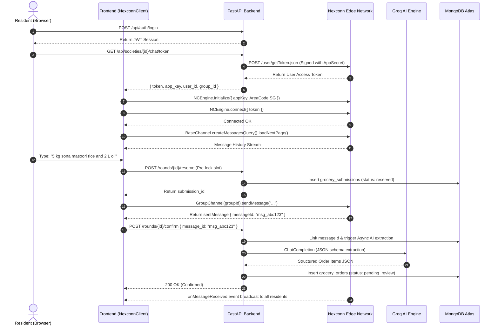

---

### Real Code Snippets from the Repository

#### 1. Server-Side Token Generation (Backend)
*From [`backend/app/services/nexconn_service.py`](file:///c:/HACKATHONS/78.%20NEXCONN%20CHALLENGE%20-%20RESKILL/APP/society-cart/backend/app/services/nexconn_service.py#L40-L78):*
```python
async def issue_nexconn_token(user_id: str, display_name: str, avatar_url: str = "") -> str:
    """Issue a user-specific chat access token from the Nexconn Server API."""
    headers = _generate_auth_headers()  # App-Key, Nonce, Timestamp, Signature (SHA1)
    url = f"{settings.nexconn_api_base_url}/user/getToken.json"
    data = {
        "userId": user_id,
        "name": display_name,
        "portraitUri": avatar_url or "",
    }
    async with httpx.AsyncClient(timeout=15.0) as client:
        resp = await client.post(url, headers=headers, data=data)
        resp_data = resp.json()
        if resp.status_code == 200 and resp_data.get("code") == 200:
            return resp_data["token"]
```

#### 2. Client Initialization & Connection (Frontend)
*From [`frontend/src/services/nexconn/nexconnClient.ts`](file:///c:/HACKATHONS/78.%20NEXCONN%20CHALLENGE%20-%20RESKILL/APP/society-cart/frontend/src/services/nexconn/nexconnClient.ts#L44-L136):*
```typescript
public initialize(appKey: string): void {
  if (this.isInitialized) return;
  NCEngine.initialize({
    appKey,
    areaCode: AreaCode.SG,
  });

  NCEngine.addConnectionStatusHandler('society_cart_connection', new ConnectionStatusHandler({
    onConnectionStatusChanged: ({ status }) => {
      this.setConnectionState(status === ConnectionStatus.CONNECTED ? 'connected' : 'disconnected');
    },
  }));
  this.isInitialized = true;
}

public async connect(token: string, userId: string, groupId: string): Promise<boolean> {
  await NCEngine.disconnect().catch(() => {});
  const result = await NCEngine.connect({ token });
  return result && result.isOk;
}
```

#### 3. Real-Time Group Chat Send & Event Listener (Frontend)
*From [`frontend/src/services/nexconn/nexconnClient.ts`](file:///c:/HACKATHONS/78.%20NEXCONN%20CHALLENGE%20-%20RESKILL/APP/society-cart/frontend/src/services/nexconn/nexconnClient.ts#L174-L215):*
```typescript
public async sendMessage(groupId: string, text: string): Promise<NexconnChatMessage> {
  const group = new GroupChannel(groupId);
  const params = new SendTextMessageParams({ text: text.trim() });
  const result = await group.sendMessage(params);
  if (!result || !result.isOk || !result.data) {
    throw new Error('Failed to send message to Nexconn channel');
  }
  return {
    id: result.data.messageId,
    senderId: this.currentUserId,
    text: text.trim(),
    sentTime: result.data.sentTime || Date.now(),
  };
}
```

#### 4. Historical Message Synchronization (Frontend)
*From [`frontend/src/services/nexconn/nexconnClient.ts`](file:///c:/HACKATHONS/78.%20NEXCONN%20CHALLENGE%20-%20RESKILL/APP/society-cart/frontend/src/services/nexconn/nexconnClient.ts#L220-L248):*
```typescript
public async fetchMessageHistory(groupId: string, pageSize = 40): Promise<NexconnChatMessage[]> {
  const query = BaseChannel.createMessagesQuery({
    channelIdentifier: new GroupChannelIdentifier(groupId),
    pageSize,
  });
  const result = await query.loadNextPage();
  const rawList: Array<Message<any>> = result.data?.data || [];
  return rawList.map((m) => this.parseRawMessage(m)).sort((a, b) => a.sentTime - b.sentTime);
}
```

---

## 6. AI Multilingual Grocery Order Parsing

Society Cart integrates **Groq Cloud API** running high-throughput LLM inference (`openai/gpt-oss-120b` or Llama 3) configured strictly with **JSON Object mode**.

### How Natural Language Becomes Structured Orders
Residents send grocery requests naturally:
- *"2 packets ashirvad aata, 5kg rice, and 2L sun flower oil"*
- *"నాకు 2 కేజీల కందిపప్పు మరియు 1 లీటర్ నూనె కావాలి"* (Telugu)
- *"Aashirvaad atta 2 packets aur thoda dhaniya"* (Hinglish)

### Structured Extraction Schema
```json
{
  "detected_language": "mixed",
  "items": [
    {
      "id": "item_1",
      "original_name": "ashirvad aata",
      "normalized_name": "Atta",
      "quantity": 2.0,
      "unit": "packet",
      "category": "grains_rice",
      "brand": "Aashirvaad",
      "variant": null,
      "confidence": 0.95,
      "needs_clarification": false,
      "clarification_reason": null
    },
    {
      "id": "item_2",
      "original_name": "thoda dhaniya",
      "normalized_name": "Coriander",
      "quantity": null,
      "unit": "bunch",
      "category": "vegetables",
      "brand": null,
      "variant": null,
      "confidence": 0.80,
      "needs_clarification": true,
      "clarification_reason": "Please specify the quantity and unit for coriander."
    }
  ],
  "overall_status": "needs_clarification",
  "clarification_prompt": "Please specify the quantity and unit for coriander."
}
```

### Deterministic Indian Taxonomy & Safety Rules
Implemented in [`backend/app/services/groq_service.py`](file:///c:/HACKATHONS/78.%20NEXCONN%20CHALLENGE%20-%20RESKILL/APP/society-cart/backend/app/services/groq_service.py):
- **Telugu Pulse Disambiguation**: "కందిపప్పు" (*kandi pappu*) maps to **Toor Dal** under `pulses` (never Chana Dal). "శనగపప్పు" maps to **Chana Dal**. "పెసరపప్పు" maps to **Moong Dal**.
- **Eggs & Bread Classification**: Eggs are strictly mapped to `other` (never `dairy`). Bread is mapped to `other` (never `bakery`).
- **Brand Preservation**: Preserves explicit brands (*Aashirvaad, Tata, Vijaya, Amul*) while discarding conversational verbs (*"teesko", "lelo", "chahiye"*).
- **Vague Quantity Guard**: Vague expressions (*"thoda", "some", "little"*) leave `quantity = null` and trigger `needs_clarification = true`.
- **Resident Review & Confirmation**: Extracted items are never submitted directly to the master manifest without explicit resident review on their dashboard.

---

## 7. System Architecture

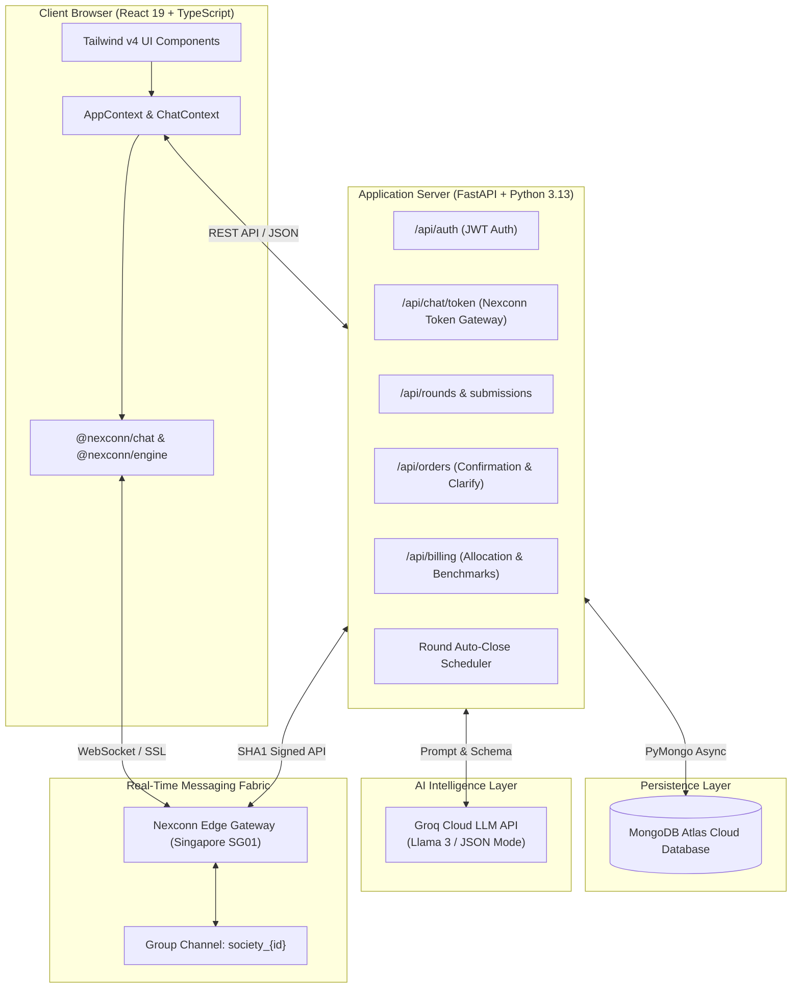

### Technology Stack Summary

| Layer | Technologies |
| :--- | :--- |
| **Frontend Framework** | React 19, TypeScript 5.7, Vite 6 |
| **Styling & Design** | Tailwind CSS v4, Lucide React Icons |
| **Messaging Client** | `@nexconn/chat` (v26.5.1), `@nexconn/engine` (v26.5.1) |
| **Backend Framework** | Python 3.13, FastAPI 0.115, Uvicorn, Pydantic v2 |
| **Database** | MongoDB Atlas, PyMongo Async Driver (v4.10) |
| **AI Inference** | Groq Cloud API (`openai/gpt-oss-120b` / Llama 3) |
| **Security & Cryptography** | SHA1 request signing, PyJWT, bcrypt password hashing |

---

## 8. Role-Based Features & Permissions

Society Cart enforces strict Role-Based Access Control (RBAC):

### 1. Admin (Society Creator)
- Creates apartment community profile with address, total flats, and custom invite code.
- Provisions society group channel on the Nexconn network.
- Manages resident memberships and promotes members to Volunteers.

### 2. Volunteer (Logistics Controller)
- **Round Lifecycle**: Schedules order rounds, sets order cutoff times, and opens/closes rounds.
- **System Announcements**: Automated broadcast messages dispatched to the Nexconn group channel.
- **Master Manifest**: Reviews consolidated item list, total kg/L quantities, and supplier order sheets.
- **Flat Packing**: Uses individual flat breakdowns to pack physical grocery bundles.
- **Record Purchases**: Logs actual store receipts (store name, items, quantities, prices).
- **Cost Allocation & Finalization**: Runs fulfillment matching engine, reviews mathematical reconciliation, finalizes bills, and triggers privacy-safe group chat alerts.

### 3. Resident
- Joins society using the community invite code and selects their flat number.
- Participates in real-time group chat powered by Nexconn.
- Submits grocery requests naturally via group chat or order submission card.
- Reviews AI-extracted items, resolves clarifications, edits quantities, and clicks **Confirm**.
- Accesses individual flat billing dashboard displaying itemized receipts and verified savings.

---

## 9. Getting Started

### Prerequisites
- **Node.js**: v18.0.0 or higher (v20+ recommended)
- **Python**: v3.10 to v3.13
- **MongoDB**: MongoDB Atlas cluster or local instance (v6.0+)
- **Nexconn Developer Account**: Access to [console.nexconn.ai](https://console.nexconn.ai)
- **Groq API Key**: From [console.groq.com](https://console.groq.com)

---

### Step 1: Clone Repository
```bash
git clone https://github.com/VivekGoudAdula/society-cart.git
cd society-cart
```

---

### Step 2: Configure Environment Variables

#### Backend Configuration (`backend/.env`)
Create `backend/.env` based on `backend/.env.example`. Variable names:
```env
APP_ENV=
BACKEND_HOST=
BACKEND_PORT=
FRONTEND_ORIGIN=

MONGODB_URI=
MONGODB_DATABASE=

JWT_SECRET_KEY=
JWT_ALGORITHM=
ACCESS_TOKEN_EXPIRE_MINUTES=
REFRESH_TOKEN_EXPIRE_DAYS=
COOKIE_SECURE=

NEXCONN_APP_KEY=
NEXCONN_APP_SECRET=
NEXCONN_API_BASE_URL=

GROQ_API_KEY=
GROQ_MODEL=
```

#### Frontend Configuration (`frontend/.env`)
Create `frontend/.env` based on `frontend/.env.example`. Variable names:
```env
VITE_API_BASE_URL=
VITE_NEXCONN_APP_KEY=
```

---

### Step 3: Getting Your Nexconn Credentials
1. Sign in to the [Nexconn Console](https://console.nexconn.ai).
2. Create an Application named **Society Cart**.
3. Under **App Information**, copy your **AppKey-Production** and **AppSecret-Production**.
4. Set `NEXCONN_APP_KEY` and `VITE_NEXCONN_APP_KEY` to your App Key (`y745wfm8yna6v`).
5. Set `NEXCONN_APP_SECRET` in `backend/.env` (keep it private).
6. Set `NEXCONN_API_BASE_URL=https://api-sg01.ronghub.com`.

---

### Step 4: Run Backend
```bash
cd backend
python -m venv venv
# On Windows:
.\venv\Scripts\activate
# On Linux/macOS:
# source venv/bin/activate

pip install -r requirements.txt
uvicorn app.main:app --host 127.0.0.1 --port 8000 --reload
```
*API Swagger Documentation will be available at [http://127.0.0.1:8000/docs](http://127.0.0.1:8000/docs).*

---

### Step 5: Run Frontend
```bash
cd frontend
npm install
npm run dev
```
*Application UI will open at [http://localhost:5173](http://localhost:5173).*

---

### Step 6: Run Automated Backend Tests
Verify the complete Nexconn, AI, and billing test suites:
```bash
cd backend
pytest tests/test_purchase_matching.py -v
pytest tests/test_phase7.py -v
```

---

## 10. Project Repository Structure

```
society-cart/
├── frontend/                          # React 19 Client Application
│   ├── public/                        # Static assets (favicons, background graphics)
│   ├── src/
│   │   ├── assets/                    # Project brand assets
│   │   ├── components/                # Reusable UI components
│   │   │   ├── billing/               # Purchase recording, allocation & savings widgets
│   │   │   ├── common/                # Buttons, cards, badges, modal primitives
│   │   │   ├── layout/                # Navbars, headers, mobile navigation
│   │   │   ├── orders/                # Extraction review and confirmation cards
│   │   │   ├── rounds/                # Order round countdown and status timers
│   │   │   └── shopping/              # Master manifest and flat packing breakdown
│   │   ├── context/                   # React context providers (AppContext, ChatContext)
│   │   ├── hooks/                     # Custom React hooks (useChat, useAuth)
│   │   ├── layouts/                   # Screen layout wrappers (AppLayout, AuthLayout)
│   │   ├── pages/                     # Top-level screen views (Welcome, Chat, Dashboards)
│   │   ├── services/
│   │   │   ├── api.ts                 # Typed backend HTTP client
│   │   │   └── nexconn/               # Nexconn Web Chat SDK integration client & types
│   │   ├── types/                     # TypeScript domain models and API contracts
│   │   ├── App.tsx                    # Route definitions and application shell
│   │   └── main.tsx                   # React root entry point
│   ├── package.json                   # Frontend dependencies (@nexconn/chat, @nexconn/engine)
│   └── vite.config.ts                 # Vite bundler configuration
│
├── backend/                           # FastAPI Application Server
│   ├── app/
│   │   ├── api/                       # REST endpoint route handlers
│   │   │   ├── auth.py                # Registration, login, JWT refresh
│   │   │   ├── billing.py             # Purchase records, allocations, savings, benchmarks
│   │   │   ├── chat.py                # Nexconn user token generation & bot messages
│   │   │   ├── orders.py              # Order extraction, review, clarify, confirm
│   │   │   ├── rounds.py              # Round schedule, opening, closing, submissions
│   │   │   └── societies.py           # Society onboarding, join codes, members
│   │   ├── core/                      # Application settings, database connection, security
│   │   ├── models/                    # Internal data schemas and constants
│   │   ├── schemas/                   # Pydantic validation request/response schemas
│   │   ├── services/                  # Core domain logic
│   │   │   ├── billing_service.py     # Robust product matching, paise allocation, savings
│   │   │   ├── groq_service.py        # Multilingual AI extraction & taxonomy normalization
│   │   │   ├── nexconn_service.py     # Nexconn server API integration (token, group, publish)
│   │   │   ├── order_service.py       # Asynchronous order processing pipeline
│   │   │   ├── round_service.py       # Round state machine and submission reservation
│   │   │   ├── round_scheduler.py     # Background auto-close deadline worker
│   │   │   └── shopping_list_service.py # Manifest consolidation and packing breakdown
│   │   └── main.py                    # FastAPI application initialization & lifespan
│   ├── tests/                         # Comprehensive pytest test suite (Phases 2-8)
│   ├── requirements.txt               # Backend Python dependencies
│   └── pytest.ini                     # Test configuration
│
└── docs/                              # Project documentation & submission media
    ├── screenshots/                   # Gallery screenshots for submission verification
    ├── ARCHITECTURE.md                # System architectural specification
    ├── NEXCONN_INTEGRATION.md         # Detailed Nexconn SDK research & blueprint
    └── Society_Cart_Nexconn_Build_Challenge_Writeup.pdf # Submission writeup
```

---

## 11. Honest Limitations & Roadmap

We believe in engineering honesty. Building for real residential communities requires acknowledging real-world constraints:

1. **Payment Collection is Offline/UPI on Delivery**: Currently, Society Cart calculates exact paise-precision itemized bills, but actual money transfer happens directly between the resident and the volunteer via UPI/cash upon package pickup.
2. **Manual Purchase Receipt Recording**: Purchase prices are entered by the volunteer from physical store invoices (e.g. D-Mart wholesale slips).
3. **AI Extraction Safeguards**: Natural language models can misinterpret quantities or misspell regional terms. Society Cart solves this by design: extracted items **never** go directly into the master shopping list until the resident reviews and clicks **Confirm**.

### Roadmap
- [ ] **Direct Supplier Wholesale Tier Integration**: Direct API connections with agricultural FPOs (Farmer Producer Organizations) and wholesale distributors.
- [ ] **In-App Escrow UPI Payments**: Automated escrow split-payments holding funds until delivery confirmation.
- [ ] **Recurring Society Order Subscriptions**: Auto-repeating monthly staples round (flour, rice, oil, pulses) on the 1st of every month.
- [ ] **Volunteer Gamification & Society Fund**: Small community discount incentives or society welfare contributions for volunteer shoppers.

---

## 12. Business & Community Growth

Society Cart leverages natural community virality:
- **Zero Dark-Store Overhead**: Traditional quick-commerce companies burn capital on micro-warehouses and delivery rider fleets. Society Cart operates with zero inventory and zero warehousing costs by utilizing the building's own community infrastructure.
- **Built-in Viral Density**: Unlike single-user apps that require high customer acquisition costs (CAC), winning one active apartment society instantly brings 50 to 300 active households onto the platform.
- **Sustainable Monetization**: A modest platform fee (1% to 2% of bulk order volume) or an optional society subscription model provides sustainable unit economics while residents still save 15% to 25% compared to quick-commerce apps.

---

## 13. Submission Acknowledgements

- **Challenge**: [Nexconn Build Challenge 2026](https://nexconn.ai)
- **Track**: **Social & Community**
- **Developed by**: Team Society Cart (`[add names]`)

> *"The aunties already figured out the business model. Society Cart gives it the technology to scale."*
