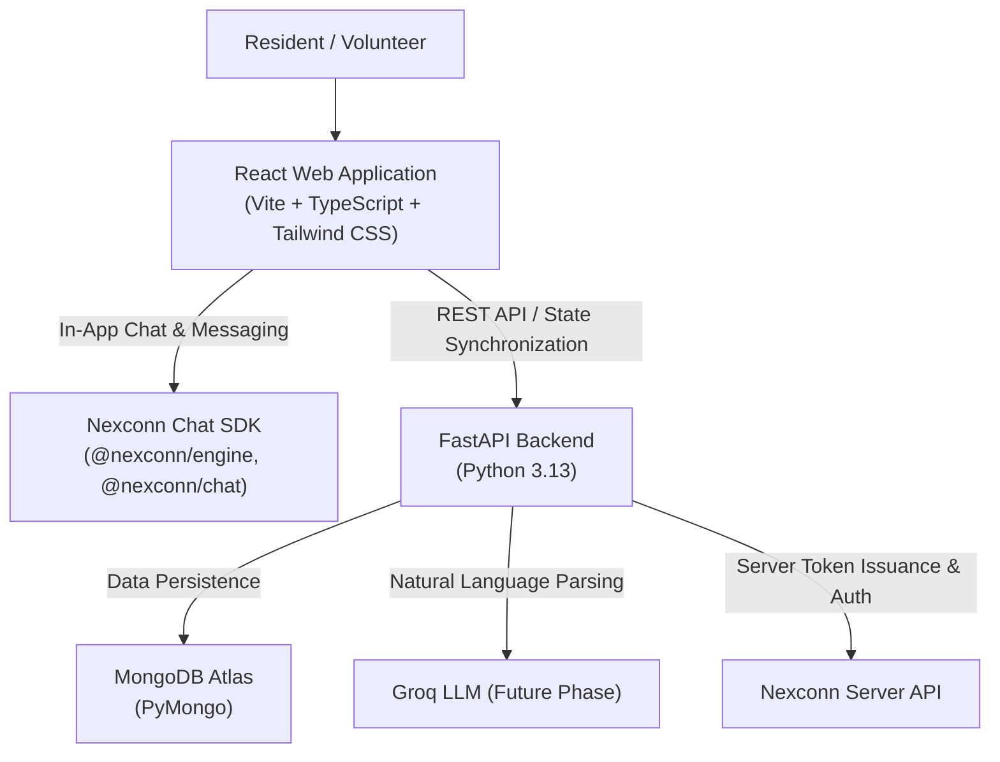

# Society Cart — System Architecture

## 1. High-Level System Overview

Society Cart is a community-based group grocery ordering platform for apartment societies. It enables residents to submit unstructured grocery orders in natural language through a shared society chat, where an AI assistant parses items and quantities into structured orders, and volunteers manage consolidated bulk purchasing.

---

## 2. Component Architecture

### A. Frontend Layer (React + Vite + TypeScript)
- **Framework**: React 19 with Vite bundler.
- **Styling**: Tailwind CSS v4.
- **Icons**: Lucide React.
- **Client Responsibilities**:
  - Presentation and layout for residents and volunteers.
  - Interactive society chat via Nexconn Web SDK & Chat UI.
  - Submitting orders and viewing active round status.
  - Volunteer bulk order review and bill distribution.
- **Security Boundary**:
  - Connects using server-issued temporary user tokens.
  - Never stores or accesses administrative secrets or MongoDB credentials.

### B. In-App Messaging Layer (Nexconn Chat Engine)
- **Engine & Core**: `@nexconn/engine` and `@nexconn/chat`.
- **UI Components**: `@nexconn/chatui` for drop-in messaging containers.
- **Messaging Scope**:
  - Society-wide group channel for real-time conversation and order submissions.
  - Message event listeners capturing grocery messages for AI processing.
  - Bot / system notifications announcing round opening, deadlines, and summaries.

### C. Backend Layer (FastAPI + Python)
- **Framework**: FastAPI with Uvicorn ASGI server.
- **Configuration**: Pydantic Settings with environment variables (`.env`).
- **Backend Responsibilities**:
  - User authentication and role-based access (Resident, Volunteer, Admin).
  - Society and flat membership management.
  - Order round lifecycle management (Open, Close, Consolidate).
  - Nexconn token generation via server-to-server credentials (`NEXCONN_APP_SECRET`).
  - Orchestration of Groq LLM for natural language order extraction.
- **Security Boundary**:
  - Securely holds `NEXCONN_APP_SECRET`, `MONGODB_URI`, and `GROQ_API_KEY`.
  - Enforces CORS policies (`FRONTEND_ORIGIN = http://localhost:5173`).

### D. Data Layer (MongoDB Atlas)
- **Database**: Cloud-hosted MongoDB Atlas cluster.
- **Driver**: PyMongo / PyMongo Async.
- **Core Planned Collections**:
  - `users`: User profiles, flat numbers, contact info.
  - `societies`: Apartment society metadata and configurations.
  - `memberships`: User-to-society bindings with role definitions.
  - `order_rounds`: Active and past shopping rounds with deadlines.
  - `orders`: Extracted, flat-wise grocery line items.
  - `bills`: Consolidated invoices, item pricing, and payment statuses.

### E. AI Layer (Groq API — Future Phase)
- **Planned Service**: High-speed LLM inference (e.g. Llama 3 on Groq).
- **Scope**:
  - Multi-lingual and informal grocery parsing (English, Hindi, Telugu, etc.).
  - Extracts item name, quantity, unit, and flat number.
  - Maps items into structured grocery lists for volunteer consolidation.

---

## 3. Communication & Data Flow

1. **Authentication & Token Issuance**:
   - Resident logs into the React frontend.
   - Frontend calls FastAPI backend (`POST /api/auth/token`).
   - Backend verifies identity, contacts Nexconn Server API using `NEXCONN_APP_SECRET`, and returns an access token.
2. **Chat Connection**:
   - Frontend initializes Nexconn Chat SDK using public `VITE_NEXCONN_APP_KEY`.
   - Connects to Nexconn edge servers using the backend-issued user token.
3. **Order Submission & Parsing**:
   - Resident messages in group chat: *"Flat 302: 5kg sona masoori rice, 1L sunflower oil"*.
   - Backend or webhook captures message, triggers Groq LLM parsing, and stores structured items in MongoDB Atlas.
4. **Order Consolidation**:
   - Volunteer closes the order round.
   - Backend aggregates identical grocery items across all flats into a master purchase list.
